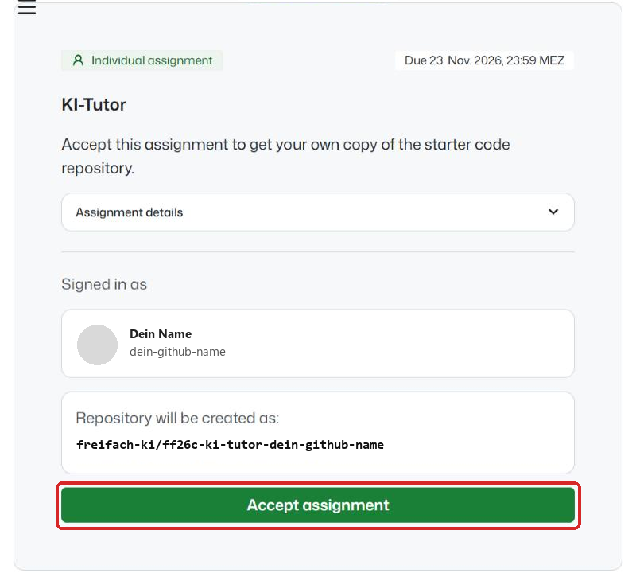
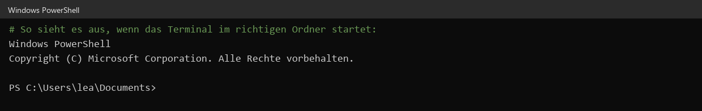
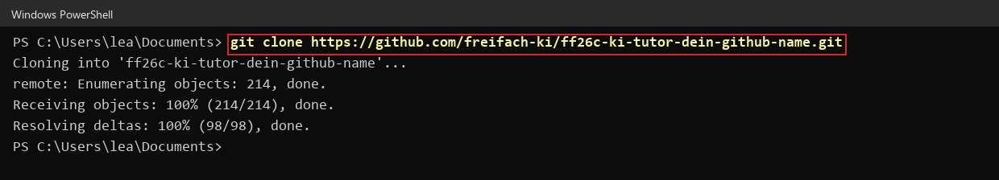
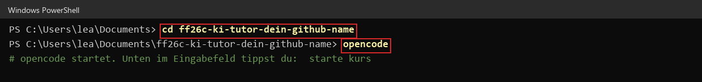
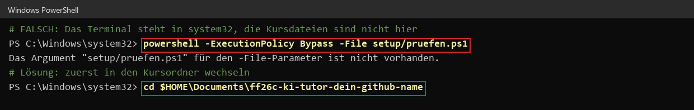

# Anleitung: Vom Einladungsmail bis «starte kurs»

Diese Anleitung bringst du am Kurstag 1 in rund 15 Minuten durch. Mach die Schritte
der Reihe nach. Steckst du fest, schau unten bei «Wenn es nicht klappt».

**Du brauchst:** deinen Laptop, Zugang zu deinem bbw-Postfach, Git und deinen
Agenten (OpenCode, Claude Code oder Codex).

---

## Schritt 1: Einladung im bbw-Postfach annehmen

1. Öffne dein bbw-Postfach. Dort liegt ein Mail von GitHub: Du bist in die
   Organisation **freifach-ki** eingeladen. Schau auch im Spam nach.
2. Klicke im Mail auf **Join @freifach-ki**.
3. **Du hast schon ein GitHub-Konto?** Melde dich an und klicke auf
   **Join freifach-ki**.
   **Du hast noch keines?** Klicke auf **Create an account** und lege eines an.
   - Benutzername: frei wählbar. Tipp: nicht dein voller Name.
   - Danach kommt ein Bestätigungscode per Mail. Gib ihn ein.
   - Dann **Join freifach-ki** klicken.

Die Einladung gilt 7 Tage.

## Schritt 2: Die Aufgabe annehmen

1. Öffne diesen Link:
   **https://classroom50.org/freifach-ki/ff26c/assignments/ki-tutor/accept**
2. Melde dich mit GitHub an, wenn danach gefragt wird, und erlaube den Zugriff.
3. Klicke auf **Accept assignment**:

   

4. Es erscheint die Seite **My submission**. Dort steht dein Repo:
   `ff26c-ki-tutor-<dein-github-name>`. Darunter steht der Befehl
   `git clone https://github.com/...`. Kopiere ihn mit dem Knopf rechts daneben.

Dein Repo ist **privat**. Nur du und die Lehrperson sehen es.

## Schritt 3: Repo auf den Laptop holen

Du hast zwei Wege. **Weg A ist der einfachste:** Dein Agent macht das Klonen für dich.

### Weg A: Der Agent klont für dich (empfohlen)

1. Öffne im Explorer deinen Ordner **Dokumente**.
2. Klicke oben in die **Adressleiste** (dort steht «Dokumente»), tippe `powershell`
   und drücke Enter. Jetzt öffnet sich ein Terminal, das schon im richtigen Ordner steht:

   

3. Tippe `opencode` und drücke Enter. (Mit Claude Code: `claude`.)
4. Kopiere diesen Auftrag in den Chat und ersetze am Schluss den Namen durch deinen
   GitHub-Namen:

   ```
   Klone mein Kurs-Repo in diesen Ordner: https://github.com/freifach-ki/ff26c-ki-tutor-DEIN-GITHUB-NAME.git
   Wenn sich ein Fenster zur Anmeldung öffnet, sag mir, was ich klicken soll.
   Sag mir danach genau, wie ich opencode im neuen Ordner neu starte.
   ```

5. Öffnet sich ein Fenster **«Connect to GitHub»**: **Sign in with your browser** wählen
   und bei GitHub anmelden. Das passiert nur beim ersten Mal.
6. Danach: opencode mit `Ctrl+C` beenden, dann

   ```
   cd ff26c-ki-tutor-DEIN-GITHUB-NAME
   opencode
   ```

### Weg B: Selbst im Terminal

1. Terminal im Ordner **Dokumente** öffnen, wie oben in Weg A, Punkt 1 und 2.
2. Den Befehl aus Schritt 2 einfügen (Rechtsklick fügt ein) und Enter drücken:

   

   Beim ersten Mal öffnet sich ein Fenster: **Sign in with your browser** wählen und bei
   GitHub anmelden.
3. In den neuen Ordner wechseln und den Agenten starten:

   

**Achtung, häufigster Fehler:** Ein Terminal aus dem Startmenü steht oft in
`C:\Windows\system32`. Dort findet nichts die Kursdateien. Darum immer zuerst `cd`
in den Kursordner, oder das Terminal über die Adressleiste öffnen wie oben:



## Schritt 4: «starte kurs» schreiben

1. Schreib im Agenten als erste Nachricht:

   ```
   starte kurs
   ```

2. Ab jetzt führt dich der Agent Schritt für Schritt durch den Kurstag. Befehle, die er
   dir nennt, tippst du am einfachsten direkt im Chat mit `!` davor, zum Beispiel
   `!git status`. Nach der Pause geht es mit **«weiter kurs»** weiter.

## Schritt 5: Am Ende jedes Kurstags hochladen

Der Agent erinnert dich daran. Du tippst die drei Befehle selbst im Terminal:

```
git add -A
git commit -m "Kurstag 1"
git push
```

Erst mit `git push` landet deine Arbeit in deinem Repo auf GitHub. Das ist deine
Abgabe. Am Kurstag 3 gilt, was bis **11:55 Uhr** hochgeladen ist.

---

## Wenn es nicht klappt

| Problem | Was du tust |
| --- | --- |
| Kein Mail von GitHub | Spam-Ordner prüfen. Sonst der Lehrperson sagen, sie schickt die Einladung neu. |
| «Not a member yet» beim Link aus Schritt 2 | Du hast die Einladung aus Schritt 1 noch nicht angenommen. Zuerst das tun, dann auf **Check again** klicken. |
| «No classrooms yet» | Eine Minute warten und die Seite neu laden. Hilft das nicht: den Link aus Schritt 2 direkt öffnen. |
| `git` wird nicht gefunden | Git ist nicht installiert. Siehe `setup/installation.md` im öffentlichen Kurs-Repo oder Lehrperson fragen. |
| Mac: Terminal fragt nach Benutzername und Passwort | Dein GitHub-Passwort funktioniert hier nicht. Du brauchst einen Token: `setup/hilfe.md`, Abschnitt 1 (auch auf github.com im öffentlichen Kurs-Repo lesbar). |
| `Repository not found` beim Klonen | Name im Befehl prüfen. Oder du bist mit einem anderen GitHub-Konto angemeldet als in Schritt 1. |
| `Please tell me who you are` beim Commit | Einmalig eingeben, mit deinem GitHub-Namen: `git config --global user.name "dein-github-name"` und `git config --global user.email "deine@bbw-adresse"` |
| Der Agent kennt «starte kurs» nicht | Du bist im falschen Ordner. Agent beenden, mit `cd` in den Ordner `ff26c-ki-tutor-<dein-github-name>` wechseln, neu starten. |
| `git push` wird abgelehnt | `setup/hilfe.md`, Abschnitt 3. Nichts erzwingen, nie `--force`. |
| Zu spät gekommen oder einen Tag verpasst | `setup/hilfe.md`, Abschnitt 5. |
